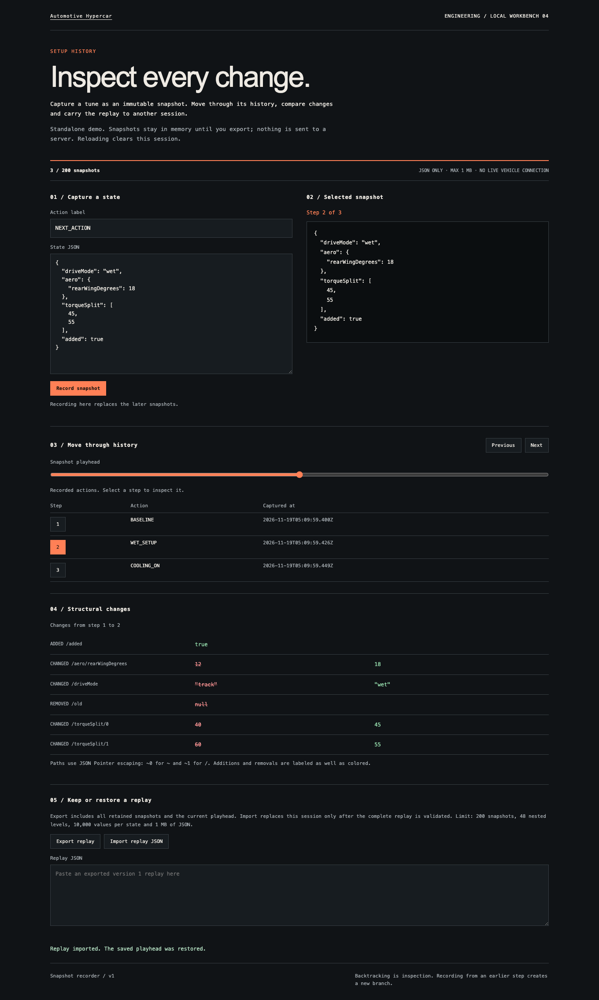
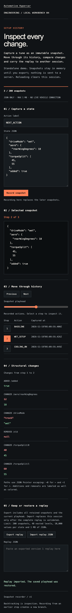

# Hypercar state debugger review

Normal production build of source `95105e8`, based on real main `199a028`. The source PR changes only the four assigned files under `public/showcase/automotive-hypercar/`.

- 15 native Node tests pass: defensive immutable snapshots, exact index boundaries, branching and retention, structural JSON Pointer diffs, finite-JSON validation, cycles/accessors/prototype-shaped keys, replay round trips, atomic malformed imports and depth/canonical byte budgets.
- Root lint exits 0 with the same 92 normalized warnings as the baseline, and no new findings. Normal Node 24 production build passes.
- Actual development and production browser flows pass: capture, previous/next/table selection, native range keyboard navigation, branch recording, decoded native replay download and import, invalid input preservation, inert HTML strings and export failure/retry.
- Widths 320, 375, 430, 850 and 1360 are contained. Normal and reduced motion checked; desktop and mobile images visually inspected.
- Served HTML, CSS and JavaScript bytes match the source on both dev and production. No browser page errors, failed resources or external requests. This is a local in-memory demonstration, with no live vehicle or backend connection.

