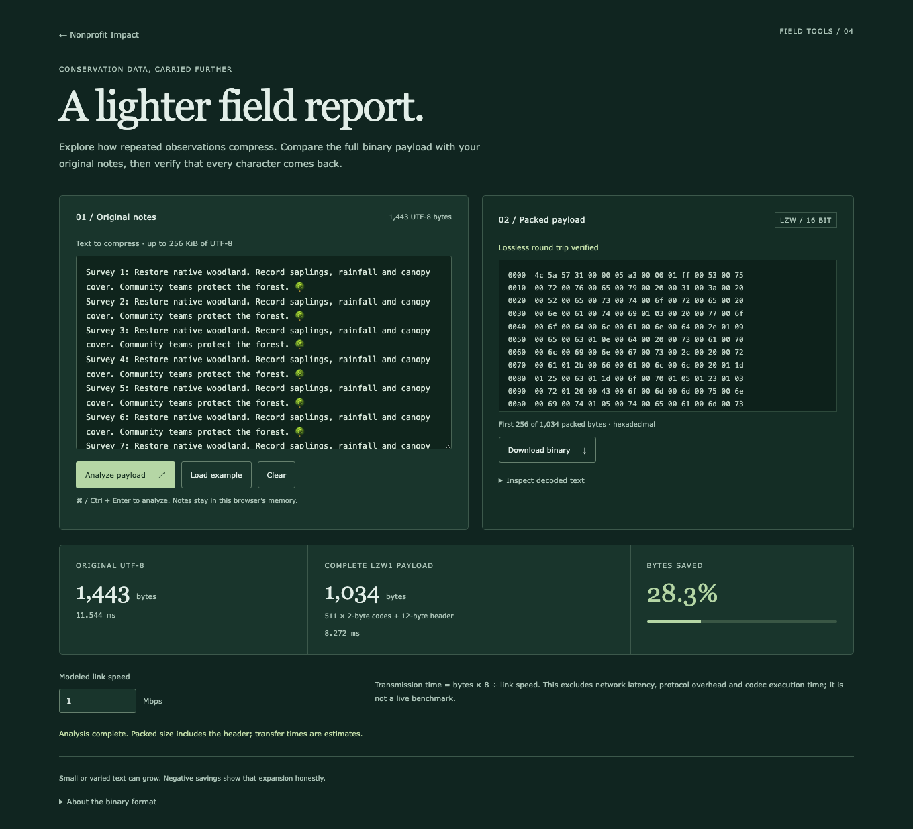
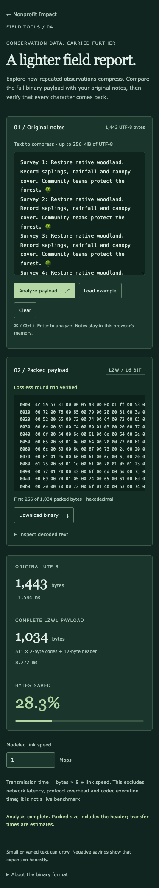

# Nonprofit payload analyzer review

Exact source `ad88d69a9fa48d9f3e849487c3734560e84b2b7f`, parent `216d89915d9c245d7867220ed300e4be3f46645a`, branch `codex/nsoc-nonprofit-compression-2234`.

Local production page `/showcase/nonprofit-impact/compression-suite.html`. A byte-alphabet LZW codec preserves valid Unicode via UTF-8, exports a documented 16-bit big-endian LZW1 binary payload, and counts its full 12-byte header. Negative savings show real expansion. The configurable link model explicitly excludes latency, protocol and CPU time. Notes remain in browser memory.

Validation: 12 native Node tests pass, including a known classic dictionary sequence, next-code decoding, Unicode/BOM/NUL round trips, malformed codes and binary headers, detached results, atomic input rejection, bounded output, portable binary offsets and invalid link speeds. 200 independently encoded deterministic varied inputs agree, and a full 256 KiB entropy payload exercises dictionary saturation/freeze and round-trip decoding.

Root lint matches all 94 inherited clean-main warnings exactly, with zero new findings. Node 24 normal production build passes. No project dependencies, lockfile, shared source or configuration changed.

Actual development and production browsers verify native keyboard controls, one-byte expansion, Unicode and BOM, empty input, oversized input rejection, stale-result download guards, independent bandwidth editing, load/clear, decoded preview boundaries, real file name/header/byte count and complete decode for FIVE download cases (sample, Unicode, empty, 10,000 CJK characters, and retry after controlled export failure). Native mobile horizontal hex scrolling, 320/375/430/850/1360px document containment, normal/reduced motion and served source identity pass. No page errors, failed resources or external requests. Final desktop/mobile images reviewed after fixing example/new-preview scroll reset.

These screenshots are on a separate fork-only evidence branch, excluded from the four-file source PR.

