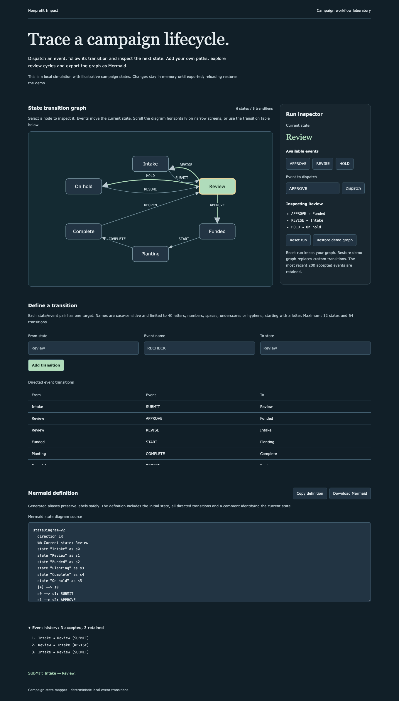
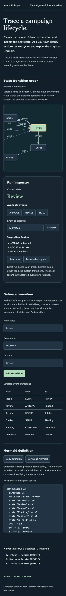

# Nonprofit campaign FSM review

Exact source `cdc2e5d7461cf57a55a77fc2979216faee63a01e`, parent `d6a92b0c7b94545a77a5bef161a49677cac8f7d5`, branch `codex/nsoc-nonprofit-fsm-2233`.

Actual local production page `/showcase/nonprofit-impact/state-diagram.html`. The graph models an illustrative campaign lifecycle in browser memory; it is separate from the existing task Kanban board. Nodes inspect transitions; only defined events move the state. The diagram scrolls natively at narrow widths; a wrapping transition table provides every full connection.

Validation: 12 native Node tests covering deterministic transitions, invalid/ambiguous atomic rejection, idempotent definitions, cycles/self-loops, detached reads, 200-event history, reset, 12-state/64-edge limits and safe aliases. Root lint matches clean current-main diagnostics (94 inherited warnings, zero new); Node 24 build passes.

Actual Mermaid 12.3.0 parsed 102 generated graphs (including cycles, reserved names, parallel paths, long labels and 64 self-loops) plus BOTH native development/production browser download files. Verification packages were installed in a separate temporary test folder; no runtime/project dependency was added.

Development and production browser flows verify node inspection without dispatch, event buttons/focus return, invalid/ambiguous rejection, duplicate definitions, cycles/self-loops/grouped parallel arrows, graph bounds, long names, reset preserving the graph, restore demo, decoded native Mermaid downloads, clipboard denial fallback and export failure/retry. Native horizontal keyboard scrolling and 320/375/430/850/1360px document containment pass. Normal/reduced motion checked; no page errors, failed resources or external requests; served source bytes match tested files. Desktop/mobile images reviewed.

The unpublished branch was fast-forwarded onto current `d6a92b0` before commit. Upstream changes only touched other showcase modules; all four final browser-tested blob IDs remained identical and root unit/lint/build checks passed again. Evidence is on this fork-only branch, excluded from the four-file source PR.

