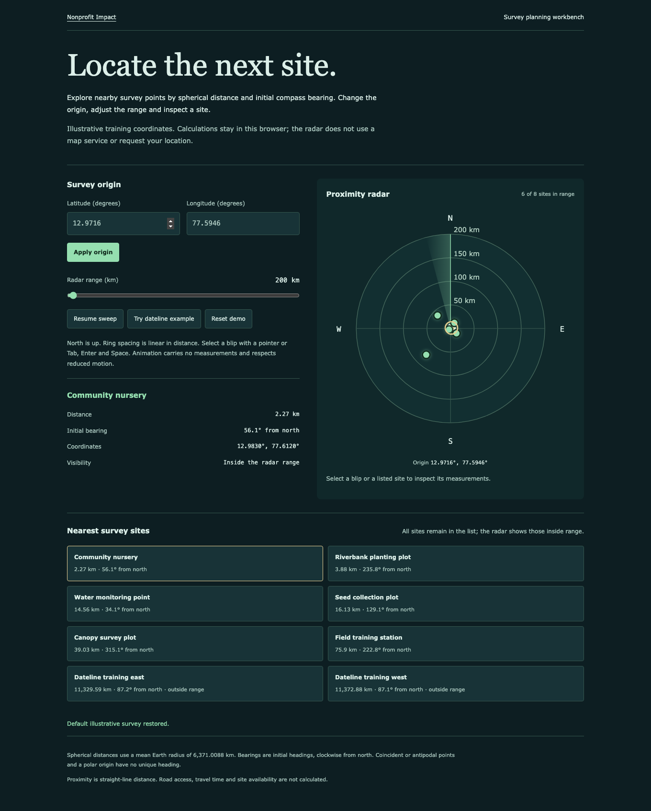
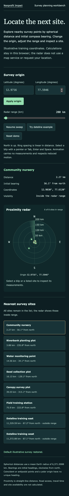

# Nonprofit survey proximity radar review

Exact source: `5de3b37287d92ca3de460d36d35436f3e10cab33`, parent `ff790f1f78b904d0e9d81ac75cb38546b49c75f3`, branch `codex/nsoc-nonprofit-geo-radar-2232`.

Standalone page `/showcase/nonprofit-impact/geo-tracker.html` uses explicitly illustrative survey coordinates and manual origin inputs. No map service, geolocation permission or external data source is used. Snapshots show the actual local production browser, after keyboard/native input, geometry and recovery tests. The foreground selection ring keeps dense nearby sites visibly selected without removing the focused SVG node.

Validation: 12 Node cases, including 200 deterministic coordinate pairs checked against an independent 3D unit-vector distance oracle; dateline wrapping, near-antipodal precision, cardinal/undefined headings, strict validation and stable sorting. Root lint has the same 94 inherited diagnostics as clean `ff790f1`, zero new findings. Node 24 normal production build passes.

Actual development and production browser controls: native origin/range, Home/End, keyboard SVG/list selection and focus retention, independently checked rendered equatorial dateline arcs in both directions, polar/antipodal sites without fabricated headings, coincident site centered, invalid origins retain previous state, reset, pause/resume and reduced motion. Layout containment at 320/375/430/850/1360px; desktop/mobile reviewed; no page errors, failed resources or external requests; served HTML/CSS/JS match source bytes.

These screenshots are kept on an evidence-only fork branch, excluded from the four-file source PR.

