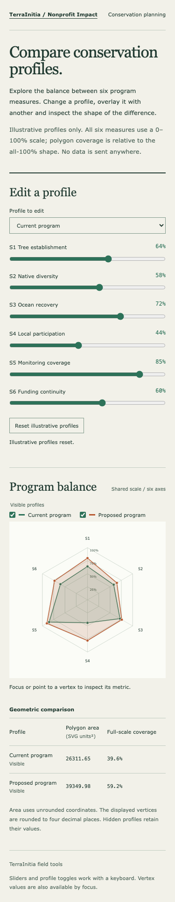

# Conservation radar review evidence

Source `ffeb4588`, based on current real main `b4787ff4`. Exactly the four assigned nonprofit data-visualizer files; shared/core/configuration files are unchanged.

- Ten native Node tests pass, including forty regular-polygon configurations and 150 varied profile comparisons against an independent radial-pair area formula. Covers finite input/dimension validation, 3–12 axes, zero/empty profiles, coordinate formatting, unrounded area precision and input isolation.
- Root lint exits 0 with the exact current-main baseline warnings and no new-file findings. Normal Node 24 production build passes. The branch was rebased before publication; upstream changes were confined to other showcase modules, with no application/configuration/dependency changes.
- Actual development and production browser flows passed for native slider Home/End, keyboard vertex focus and hover labels, independent area calculation from rendered SVG coordinates, profile isolation and show/hide persistence, zero/empty states and reset.
- 320, 375, 430, 850 and 1360px contained layouts; normal/reduced motion. Desktop/mobile images visually reviewed. Served HTML/CSS/JS bytes match source; no page errors, failed resources or external requests.
- Two fictional conservation profiles, each with six percentage measures. Polygon coverage is a geometric comparison to the all-100% shape. No production dataset or backend connection is claimed.

