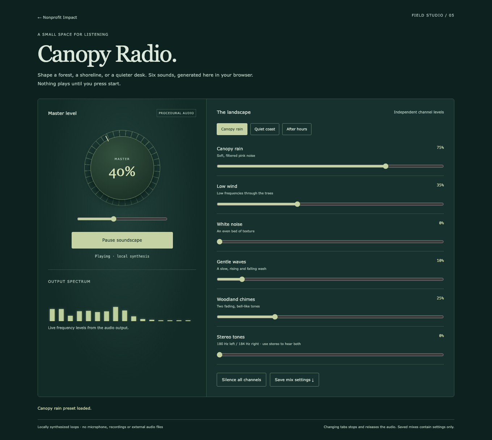
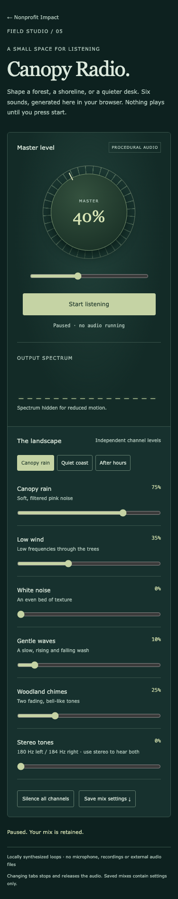

# Nonprofit soundscape mixer review

Exact source `d8d5ab6363d0ee81189b7a83f05d15cf0bd53ae0`, parent `b8d06e6bfef9f7693ed5dfa6f3cc7530c7fe0735`, branch `codex/nsoc-nonprofit-soundscape-2235`. Local production page `/showcase/nonprofit-impact/ambient-soundscape.html`.

Six procedural channels: filtered pink-noise rain/wind, white noise, slowly modulated waves, fading chimes and stereo 180/184 Hz tones. Playback requires the native start control. The mixer owns its context and sources; suspend/resume preserves the mix, while real page hiding/navigation closes the owned context. No microphone, recording, external audio files, network calls or project dependencies.

Validation: 12 native Node tests pass for finite clamped gains, detached presets, versioned settings round trips, malformed settings, one-pole filter math, seeded noise/bounds/loop fades, measured pink spectrum, lazy context creation and partial-graph failure cleanup. Root lint exactly matches clean current main (94 inherited warnings, zero new findings). Node 24 normal production build passes.

Actual OfflineAudioContext renders verify all six isolated channels produce finite nonzero PCM, zero-gain channels produce exact silence, left/right tone energy isolates 180/184 Hz by more than 1000:1, and real bandpass/lowpass responses match the intended filters. A 12-second all-channel 100% mix peaks at 0.1594 without clipping. [Measured results](./offline-audio-results.json) and [four-second default Canopy WAV](./offline-canopy.wav) use the exact production graph. The WAV is synthetic offline output, not a recording.

Three independent native development/production browser sessions each (six total) pass keyboard focus, actual float audio signal, live analyser spectrum, master/channel silence, paused audio clock, resumed single six-source graph, native settings download/failure/retry, no autoplay, actual pagehide closure, clean reload, unsupported API/resume failure recovery, 320/375/430/850/1360px layouts and normal/reduced motion. An observing AudioWorklet captured the first 4096 frames after muted resume: all samples were exactly zero in every session. [Browser results](./browser-results.json). No page errors, failed resources or external requests; served source bytes match tested files.

The [Web Audio specification](https://www.w3.org/TR/webaudio/#dom-audioparam-value) distinguishes the intrinsic AudioParam value from scheduled automation. The mixer resets both before resume, then ramps toward the selected level. The native button also retains keyboard focus across asynchronous pause/resume.

Desktop shows actual playing frequency bands; mobile shows paused reduced-motion output. Both images reviewed. This fork-only evidence branch is excluded from the four-file source PR.

