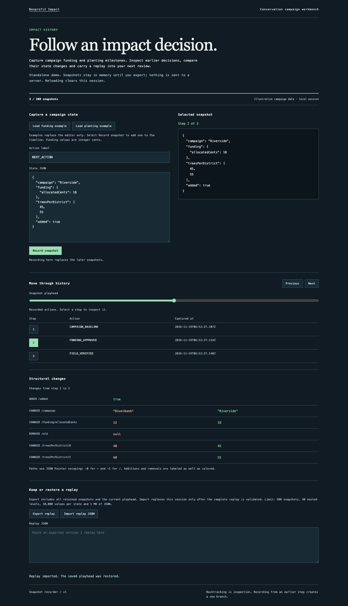
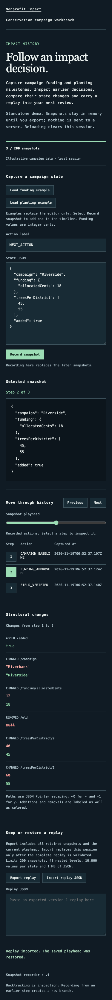

# Nonprofit Impact state recorder review

Source: `07a5cbb4b804da2654f0b636650b4cb7f1bcd7be` on `codex/nsoc-nonprofit-state-recorder-1080`.

Actual local production browser at `/showcase/nonprofit-impact/state-debugger.html`. The standalone workbench uses illustrative conservation data; no live funds, donor data or server connection is involved. Screens show a historical playhead, nested funding/tree differences and retained future snapshots.

Validation: 16 native Node cases; root lint with 94 inherited warnings identical to clean `d715237` diagnostics and zero new findings; Node 24 production build; development and production native controls, campaign examples, time travel/branching, JSON Pointer changes, downloaded replay round trip, atomic invalid-import recovery, inert HTML rendering and download error/retry. Keyboard range navigation/history focus; 320/375/430/850/1360px containment; normal/reduced motion; no page errors, failed resources or external requests; served source byte equality. Desktop/mobile screenshots reviewed.

The immutable recorder and JSON validation core reuse the accepted automotive recorder, with the issue-required independent nonprofit class and four-file isolation, nonprofit examples and local replay naming. Screenshots stay on this evidence branch and are excluded from the four-file source PR.

