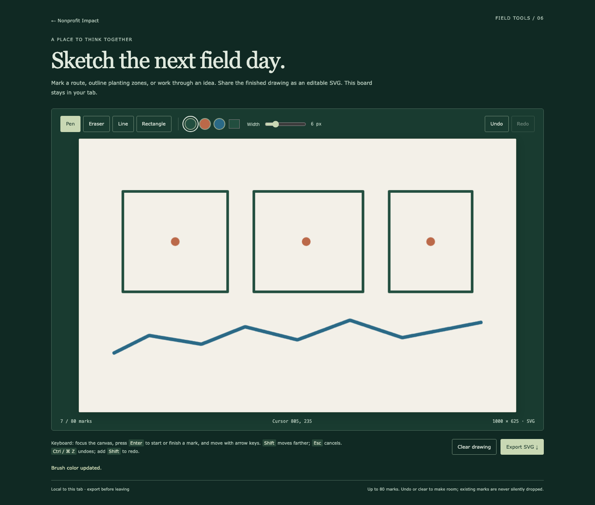
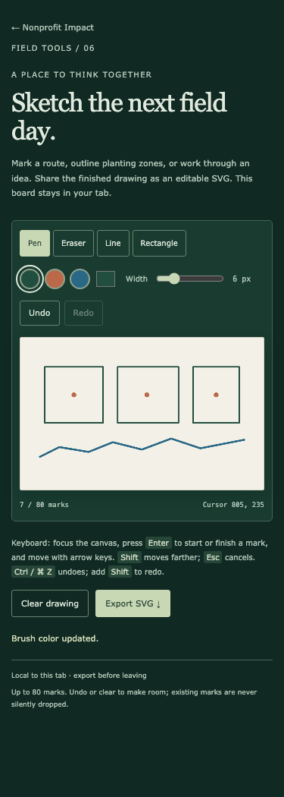

# Nonprofit field sketchpad review

Exact source `75a5e2ccb47f3dd5631b7c5f5822ec1c76709e9c`, parent `1be119d2e7508a6e2dabc5f2cb33818b1cfc599e`, branch `codex/nsoc-nonprofit-whiteboard-2083`. Actual production page `/showcase/nonprofit-impact/canvas-whiteboard.html`.

The detailed issue checklist is a self-contained local drawing tool. Pen/eraser strokes are resampled and smoothed; line/rectangle tools retain two endpoints. Undo/redo branch correctly; limits reject new data without silently dropping artwork. Completed marks export as a standalone SVG, with ordered luminance masks preserving erasing while allowing later ink on top. Drawings stay in the current tab; there is no remote real-time collaboration.

13 native Node tests pass, including 200 independent varied interpolation comparisons, finite/clamped coordinates, unsafe settings rejection, shape geometry, draft cancellation, undo/redo branching, 80-mark and 1024-point limits, SVG mask order, clear/reset and maximum bounded SVG below 5 MiB. Root lint matches clean current main exactly: 94 inherited warnings, zero new findings. Node 24 normal production build passes. No shared files, dependencies, configuration or workflows changed.

Actual development and production browsers verify all four tools through native pointer input and real canvas pixels. Every pointer-down waits a real animation frame, including a rectangle with only its first corner. Native downloads were saved, decoded as SVG images and checked pixel-by-pixel at ink, erased, later-ink, line, rectangle and paper locations. XML parse errors/scripts are absent. [Decoded results](./browser-results.json) and [regression SVG export](./regression-drawing.svg). The export is the mixed-shape eraser regression case; screenshots show a separate example drawn through native pointer controls.

Native pointer-capture loss cancels a draft, touch cancellation does not commit, completed touch drawing does not scroll, and keyboard Enter/arrows/Escape/undo/redo work. Focus returns to the canvas when a history button becomes disabled. The 81st mark is rejected with existing pixels retained. Clear confirmation accept/dismiss, export failure/retry retaining identical SVG, unsupported Canvas fallback, normal/reduced motion, 320/375/430/850/1360px document containment and served source identity pass. No page errors, failed resources or external requests.

Final desktop/mobile images reviewed. Evidence stays on this separate fork-only branch and is excluded from the four-file source PR.

